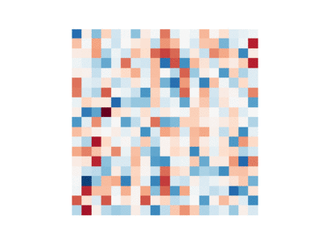
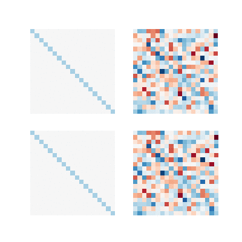

# Gaussian elimination

Here is a simple visualization of the Gaussian elimination steps:

Below is a more complete version:

For more details, the Python source code is available here: [https://github.com/josephsalmon/Tweets/tree/master/Pivot_Gauss_video](https://github.com/josephsalmon/Tweets/tree/master/Pivot_Gauss_video)
